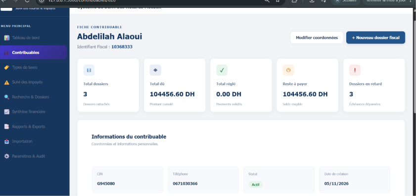
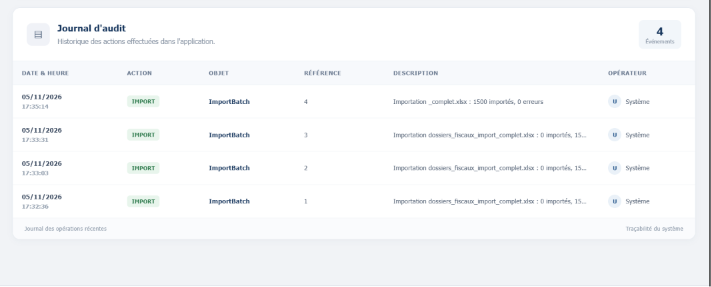
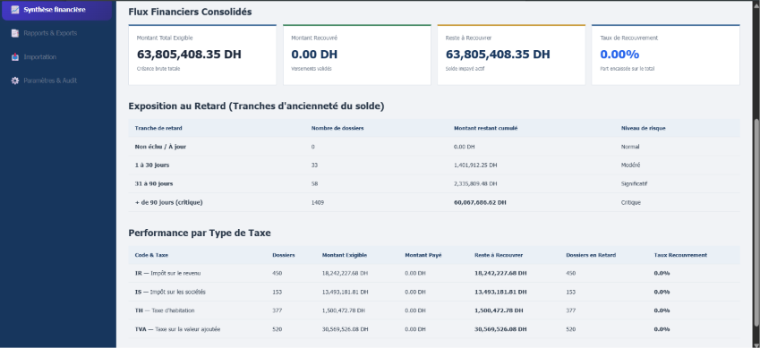
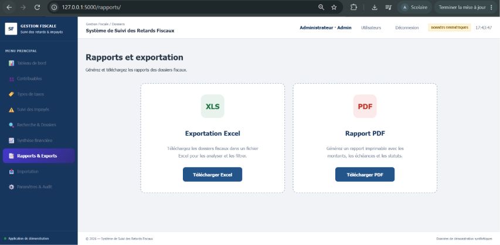
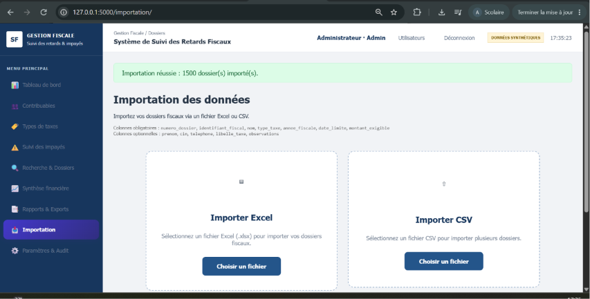
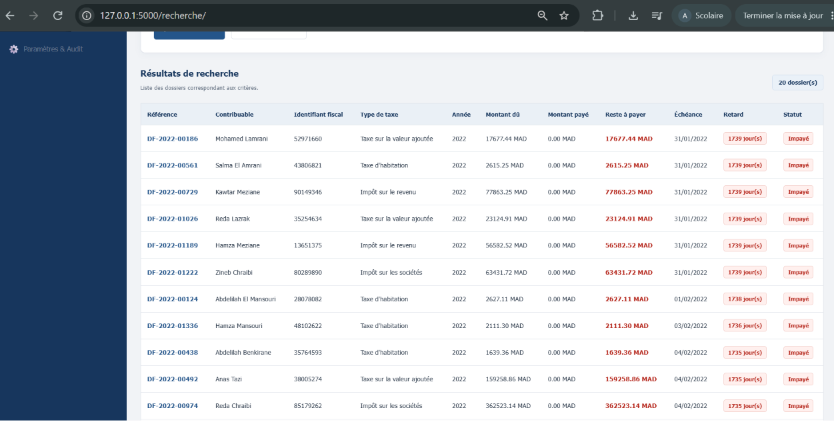
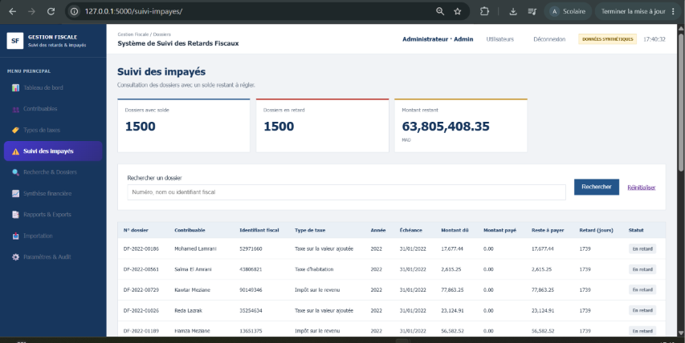

# Système de Suivi des Retards Fiscaux

<p align="center">
  <strong>Application web de démonstration pour la gestion et le suivi des dossiers fiscaux</strong><br>
  <em>Contribuables · Dossiers · Paiements · Impayés · Relances · Rapports</em>
</p>

<p align="center">
  
  
  
  
  
</p>

---

## Présentation

**Système de Suivi des Retards Fiscaux** est une application web développée avec **Python et Flask**. Elle propose une interface centralisée permettant de consulter et de gérer des données fiscales fictives, de suivre les paiements et d'identifier les dossiers présentant un retard.

Le projet a pour objectif de mettre en pratique le développement d'une application web complète : architecture Flask organisée par modules, gestion d'une base de données relationnelle, authentification, contrôle des accès, importation de fichiers Excel et génération de rapports PDF.

> [!IMPORTANT]
> **Projet de démonstration uniquement.** L'application utilise une base de données locale et des données fictives. Elle n'est connectée à aucun système officiel de la Direction Générale des Impôts (DGI), à GID ou à Rokhas. N'y introduisez aucune donnée fiscale ou personnelle réelle.

## Aperçu de l'application

Les captures ci-dessous présentent différentes parties de l'interface. Les fichiers originaux fournis sont conservés dans [`assets/screenshots/`](assets/screenshots/).

### Tableau de bord

Vue synthétique des dossiers et de leur situation.



### Suivi des impayés et consultation des dossiers

Consultation des dossiers, des montants dus et des informations de suivi.

<p align="center">
  
  
</p>

### Importation et gestion des données

Écrans de gestion et d'importation des données de démonstration.

<p align="center">
  
  
</p>

### Recherche, synthèse et rapports

Interfaces de consultation, de recherche et de présentation des informations.

<p align="center">
  
  
</p>

## Fonctionnalités

- **Tableau de bord** : aperçu des principaux indicateurs et de l'activité.
- **Gestion des contribuables** : consultation et organisation des fiches contribuables.
- **Gestion des dossiers fiscaux** : suivi des dossiers et de leurs informations.
- **Suivi des paiements** : consultation des paiements et des montants restant dus.
- **Suivi des impayés** : identification et consultation des dossiers en retard.
- **Relances** : enregistrement et suivi des relances effectuées dans l'application.
- **Recherche avancée** : recherche et filtrage des informations.
- **Importation Excel** : intégration de données depuis des fichiers Excel avec Pandas et OpenPyXL.
- **Rapports PDF** : génération de documents PDF avec ReportLab.
- **Authentification et rôles** : accès différencié selon le profil utilisateur.
- **Journalisation** : traçabilité applicative de certaines opérations.

*Les fonctionnalités disponibles dépendent de l'état de développement de la version installée.*

## Technologies utilisées

| Domaine | Technologies |
|---|---|
| Langage | Python 3.11+ |
| Backend | Flask |
| ORM et base de données | Flask-SQLAlchemy, SQLite |
| Migrations | Flask-Migrate |
| Formulaires et protection CSRF | Flask-WTF |
| Authentification | Flask-Login |
| Import Excel | Pandas, OpenPyXL |
| Export PDF | ReportLab |
| Tests | Pytest |
| Base de données alternative | PostgreSQL via `DATABASE_URL` |

## Architecture du projet

L'application est organisée en modules fonctionnels afin de séparer les responsabilités et de faciliter la maintenance.

```text
suivi-retards-fiscaux/
├── app/
│   ├── auth/              # Authentification, utilisateurs et rôles
│   ├── accueil/           # Tableau de bord
│   ├── contribuables/     # Gestion des contribuables
│   ├── dossiers/          # Gestion des dossiers fiscaux
│   ├── importation/       # Importation des fichiers Excel
│   ├── models/            # Modèles de données SQLAlchemy
│   ├── paiements/         # Gestion des paiements
│   ├── parametres/        # Paramètres de l'application
│   ├── rapports/          # Rapports et exports PDF
│   ├── recherche/         # Recherche avancée
│   ├── relances/          # Suivi des relances
│   ├── services/          # Logique métier partagée
│   ├── suivi_impayes/     # Suivi des retards et impayés
│   ├── synthese/          # Indicateurs et synthèses
│   ├── types_taxes/       # Types de taxes
│   ├── static/            # CSS, JavaScript et ressources
│   └── templates/         # Templates Jinja
├── migrations/            # Historique des migrations
├── tests/                 # Tests automatisés
├── instance/              # Données locales (non versionnées)
├── requirements.txt
├── run.py                 # Point d'entrée de l'application
└── README.md
```

## Installation

### Prérequis

- Windows, Linux ou macOS
- Python **3.11 ou supérieur**
- `pip`
- Git (facultatif, pour cloner le dépôt)

### 1. Récupérer le projet

```bash
git clone <URL_DU_DEPOT>
cd suivi-retards-fiscaux
```

Si le projet est déjà présent sur votre ordinateur, ouvrez simplement son dossier dans le terminal.

### 2. Créer et activer l'environnement virtuel

**Windows – PowerShell :**

```powershell
py -3.11 -m venv env
.\env\Scripts\Activate.ps1
```

**Windows – Invite de commandes (CMD) :**

```cmd
py -3.11 -m venv env
env\Scripts\activate.bat
```

**Linux / macOS :**

```bash
python3.11 -m venv env
source env/bin/activate
```

### 3. Installer les dépendances

```bash
python -m pip install --upgrade pip
pip install -r requirements.txt
```

## Configuration

Créez un fichier `.env` à partir du modèle fourni, si le fichier `.env.example` existe :

**PowerShell :**

```powershell
Copy-Item .env.example .env
```

**CMD :**

```cmd
copy .env.example .env
```

Générez une clé secrète :

```bash
python -c "import secrets; print(secrets.token_hex(32))"
```

Ajoutez cette valeur dans votre fichier `.env` :

```dotenv
SECRET_KEY=remplacer_par_une_cle_secrete_longue_et_aleatoire
FLASK_DEBUG=False
```

Ne publiez jamais votre fichier `.env` et ne placez pas de clé secrète directement dans le code source.

> Si le projet ne contient pas encore de fichier `.env.example`, créez le fichier `.env` manuellement et renseignez les variables réellement prises en charge par la configuration de l'application.

## Initialisation et lancement

Depuis la racine du projet, avec l'environnement virtuel activé :

### 1. Appliquer les migrations

```bash
flask --app run.py db upgrade
```

Si la commande de migration n'est pas configurée dans votre environnement, utilisez la commande d'initialisation prévue par le projet :

```bash
flask --app run.py init-auth-db
```

> Utilisez la procédure correspondant à l'état de la base de données. Évitez de mélanger migrations et création manuelle des tables sur une base déjà initialisée.

### 2. Créer le premier compte administrateur

```bash
flask --app run.py create-admin
```

Suivez les instructions affichées dans le terminal pour créer le compte.

### 3. Démarrer le serveur de développement

```bash
python run.py
```

Ouvrez ensuite l'application dans votre navigateur :

**http://127.0.0.1:5000**

Pour arrêter le serveur, utilisez `Ctrl + C` dans le terminal.

## Gestion des rôles

| Rôle | Autorisations |
|---|---|
| `admin` | Accès complet, paramètres et gestion des comptes |
| `agent` | Consultation et modification des données métier |
| `consultation` | Consultation en lecture seule |

Les autorisations doivent être contrôlées côté serveur, et pas uniquement en masquant les boutons dans l'interface.

## Tests

Lancer l'ensemble des tests :

```bash
python -m pytest
```

Avec un rapport de couverture, si `pytest-cov` est installé :

```bash
python -m pytest --cov=app --cov-report=term-missing
```

## Sécurité et limites

Cette application est conçue pour un environnement local de démonstration. Avant tout usage réel, plusieurs mesures complémentaires sont indispensables :

- définir une `SECRET_KEY` robuste à l'aide d'une variable d'environnement ;
- désactiver le mode debug en dehors du développement ;
- imposer une politique de mots de passe robuste et adaptée ;
- protéger les routes et vérifier les permissions sur le serveur ;
- utiliser HTTPS et un serveur WSGI adapté en production ;
- sécuriser les sauvegardes et limiter l'accès à la base de données ;
- définir une politique de conservation et de suppression des données ;
- renforcer la journalisation, la supervision et la traçabilité ;
- vérifier les fichiers importés (format, taille, contenu et données) ;
- ne pas considérer une relance enregistrée comme une preuve d'envoi réel d'un SMS, d'un e-mail ou d'un courrier ;
- ne pas considérer les journaux applicatifs comme un stockage d'audit inviolable.

**Aucune donnée personnelle ou fiscale réelle ne doit être utilisée dans cette version de démonstration.**

## Déploiement : recommandations

Pour envisager un déploiement hors environnement pédagogique :

1. Configurer les secrets et variables d'environnement sur le serveur.
2. Utiliser PostgreSQL plutôt que la base SQLite locale.
3. Déployer avec un serveur WSGI (par exemple Gunicorn sous Linux ou Waitress sous Windows).
4. Placer l'application derrière un reverse proxy configuré en HTTPS.
5. Mettre en place des sauvegardes régulières et tester leur restauration.
6. Ajouter supervision, journalisation centralisée et gestion des incidents.
7. Réaliser des tests de sécurité et de charge avant toute mise en service.

## Licence et utilisation

Ce dépôt constitue un **projet pédagogique et une démonstration technique**. Aucune affiliation avec la Direction Générale des Impôts ou avec un système administratif officiel n'est revendiquée.

Toute réutilisation doit respecter les règles applicables en matière de sécurité, de confidentialité et de protection des données.
